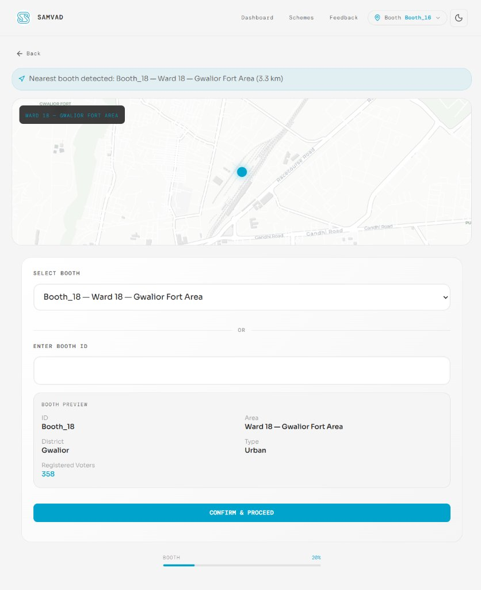
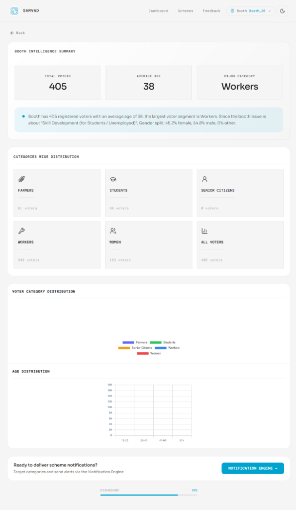
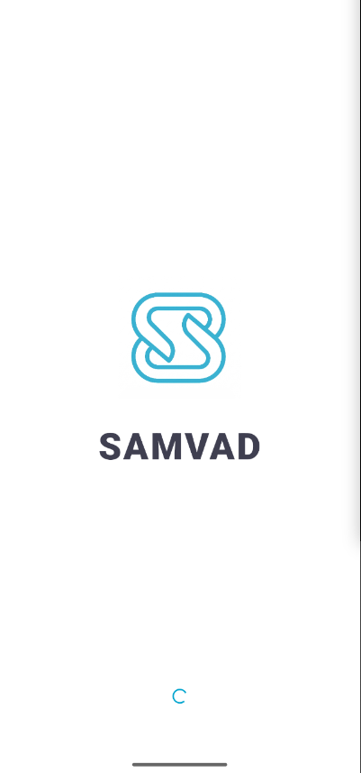
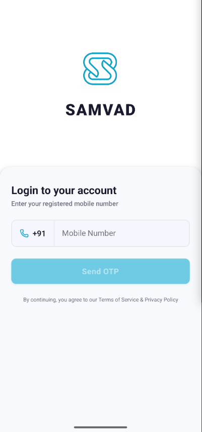
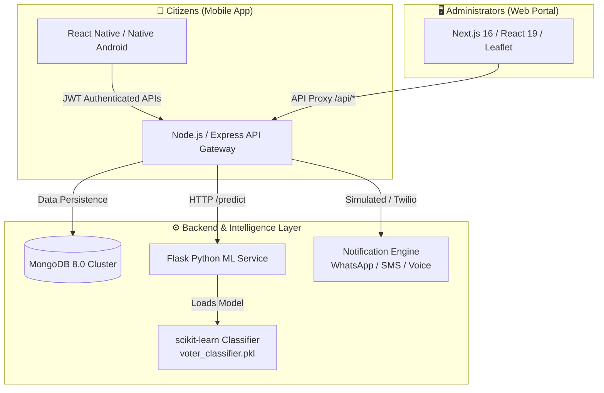

<p align="center">
  
</p>

<h1 align="center">SAMVAD (संवाद)</h1>

<p align="center">
  <strong>Intelligent Citizen Engagement & Voter Intelligence Platform</strong><br>
  <em>Bridging the gap between governance, public schemes, and citizens through data-driven dialogue.</em>
</p>

<p align="center">
  
  
  
  
  
  
  
</p>

<p align="center">
  <a href="#-about-samvad">About</a> •
  <a href="#-visual-showcase">Showcase</a> •
  <a href="#-system-architecture">Architecture</a> •
  <a href="#-key-features">Features</a> •
  <a href="#-monorepo-structure">Structure</a> •
  <a href="#-quick-start">Quick Start</a> •
  <a href="#-testing--verification">Testing</a> •
  <a href="#-configuration">Configuration</a>
</p>

---

## 📖 About SAMVAD

**SAMVAD** (*Sanskrit for "dialogue" or "constructive conversation"*) is an end-to-end civic intelligence ecosystem. In modern representative governance, communicating welfare initiatives to the right beneficiaries is often hindered by fragmented data and manual processes.

SAMVAD solves this through:
- **Constituency Booth Analytics**: Micro-level demographic segmentation (Farmers, Students, Senior Citizens, Workers, Women).
- **Targeted Scheme Delivery**: Personalized recommendation engine powered by Machine Learning matching citizens with central and state welfare initiatives.
- **Citizen Empowerment**: Direct mobile interface for eligibility checks, scheme applications, and community feedback.
- **Automated Campaign Dissemination**: Multi-channel broadcast simulation (SMS, WhatsApp, and Voice calls).

---

## 📸 Visual Showcase

### 🖥️ Web Intelligence Dashboard (Representatives & Administrators)

<table>
  <tr>
    <td width="50%" align="center">
      <strong>📍 Nearest Booth Discovery & Leaflet Map</strong><br><br>
      
      <p align="left"><em>Automatic geolocation calculation, GPS radius detection, and interactive CARTO/Leaflet map visualization across electoral wards.</em></p>
    </td>
    <td width="50%" align="center">
      <strong>📊 Real-Time Booth Demographics & Insights</strong><br><br>
      
      <p align="left"><em>Dynamic breakdown of booth voter populations by occupation, age distribution charts, and one-click notification targeting.</em></p>
    </td>
  </tr>
</table>

### 📱 Citizen Mobile Application (React Native)

<table>
  <tr>
    <td width="50%" align="center">
      <strong>✨ Fluid Launch Screen</strong><br><br>
      
      <p align="center"><em>Native splash screen and smooth startup onboarding flow.</em></p>
    </td>
    <td width="50%" align="center">
      <strong>🔐 Passwordless OTP Authentication</strong><br><br>
      
      <p align="center"><em>Direct mobile login with instant OTP delivery and JWT token validation.</em></p>
    </td>
  </tr>
</table>

---

## 🏛️ System Architecture



---

## ✨ Key Features

### 1. 📊 Booth Analytics & Demographics
- **Automated Segmentation**: Categorizes voters into strategic groups: *Farmers*, *Students*, *Workers*, *Senior Citizens*, and *Women*.
- **Interactive Mapping**: Ward and booth locator powered by Leaflet and high-contrast CARTO basemaps.
- **Visual Intelligence**: Demographics visualization with age distribution charts and key statistics.

### 2. 🧠 Machine Learning Scheme Recommendation
- **Predictive Matching**: scikit-learn classification model trained on voter demographics, issues, and area context to suggest top-fitting welfare initiatives.
- **Micro-Targeted Campaigns**: Enables booth managers to trigger notification campaigns for specific categories with zero manual filtering.

### 3. 📱 Citizen Portal (Mobile App)
- **Passwordless Access**: Secure mobile OTP sign-in with instant verification.
- **Smart Eligibility Wizard**: Interactive questionnaire evaluating income, category, and occupation to recommend relevant schemes.
- **Application & Feedback**: Track application status in real-time and submit ground-level feedback directly to representatives.

---

## 📂 Monorepo Structure

```text
SAMVAD/
├── assets/                    # Presentation assets, screenshots, and logos
├── SAMVAD-Web/                # Next.js 16 Web Dashboard (React 19, Tailwind CSS)
│   ├── src/app/               # App Router pages (booth-selection, dashboard, schemes)
│   └── src/components/        # Charts, Leaflet map components, theme toggles
├── SAMVAD-BACKEND/            # Express 5 REST API & Machine Learning engine
│   ├── controllers/           # API route controllers (voters, booths, auth, campaigns)
│   ├── models/                # Mongoose database models (Voter, Booth, Scheme, User)
│   ├── ml/                    # Flask ML service & trained scikit-learn models
│   └── data/                  # Seed datasets (Voters, Booths, Schemes, Context)
├── SAMVAD-Mobile/             # Native React Native Mobile Application
│   ├── android/               # Bare native Android Gradle build configuration
│   ├── ios/                   # Bare native iOS Xcode project
│   └── src/                   # Navigation, theme, screens (Auth, Schemes, Profile)
├── scripts/                   # Cross-platform orchestration scripts (dev, test, db, smoke)
└── package.json               # Root monorepo orchestration
```

---

## 🚀 Quick Start

### Prerequisites
- **Node.js**: `v22.11.0` or higher
- **Python**: `3.11` to `3.14` with venv support
- **Docker**: For local MongoDB container
- **Android Studio & SDK** *(optional, for running Android app)*: Java 17, Android SDK Platform 36

### 1. Installation & Environment Setup
Clone the repository and run the automated setup:

```bash
git clone https://github.com/lovemishra28/SAMVAD.git
cd SAMVAD

# Installs all packages, configures .env files, builds python venv, and seeds MongoDB
npm run setup
```

### 2. Launch Local Development Services
Start the unified stack with a single command:

```bash
npm run dev
```

This concurrently launches:
| Service | Environment | URL |
| :--- | :--- | :--- |
| **Web Dashboard** | Next.js (Turbopack) | `http://localhost:3000` |
| **API Backend** | Express / Node.js | `http://localhost:5000` |
| **ML Engine** | Flask / scikit-learn | `http://localhost:5001` |
| **Mobile Metro** | React Native Packager | `http://localhost:8081` |
| **Database** | MongoDB 8.0 (Docker) | `127.0.0.1:27017` |

> [!TIP]
> Stop all services with `Ctrl + C`. MongoDB persists in its Docker volume. Run `npm run db:stop` if you wish to shut down the container.

---

### 3. Launch Android Mobile App

Start your Android emulator, then open a second terminal:

```bash
cd SAMVAD
npm run android
```

#### Demo Mobile Credentials:
- **Mobile Number**: `7000000000` (Vijay Patel - Seeded student profile)
- **OTP**: Enter the 6-digit `[DEV OTP]` printed directly in your backend terminal console.

---

## 🧪 Testing & Verification

The repository includes a comprehensive testing suite for both unit and end-to-end integration:

```bash
# 1. Run all unit tests (Backend tests + Mobile TypeScript & Jest)
npm run check

# 2. Test web production build
npm run build:web

# 3. Full-stack smoke test (MongoDB, ML predictions, Web Proxy, all routes)
npm run smoke

# 4. Mobile API end-to-end test (Simulated isolated database test)
npm run smoke:mobile

# 5. Free dev ports if any process lingered
npm run clean:ports
```

---

## ⚙️ Configuration & Environment

| Service | Environment File | Notes |
| :--- | :--- | :--- |
| **Web Dashboard** | `SAMVAD-Web/.env.local` | `BACKEND_URL=http://127.0.0.1:5000`<br>`NEXT_PUBLIC_CARTO_API_KEY` (CARTO basemap key) |
| **Backend** | `SAMVAD-BACKEND/.env` | `MONGODB_URL`, `JWT_SECRET`, `PORT=5000`<br>`MESSAGING_MODE=console` (Use `twilio` for production) |
| **Mobile App** | `SAMVAD-Mobile/src/api/config.ts` | Configures `10.0.2.2:5000` for Android emulator or `localhost:5000` for iOS |

---

## 🛡️ License

This project is licensed under the [ISC License](LICENSE).
<br>
Built with ❤️ for citizen-first digital governance.
